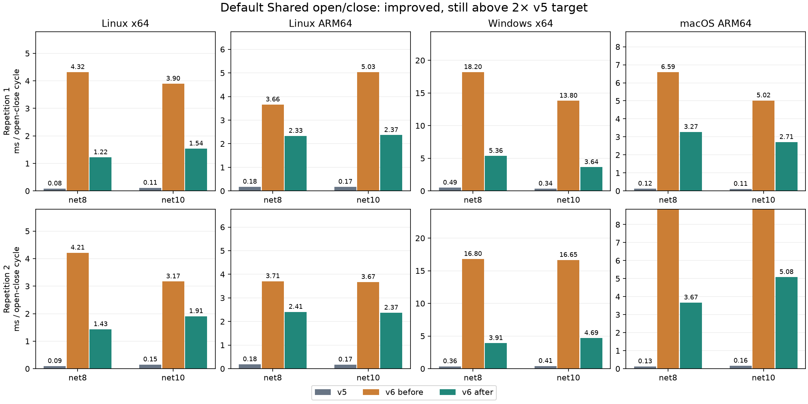

# P5-SHARED-OPEN

The patch substantially reduces Shared open/close time, but **does not meet the requested <=2x v5 target**. Default after/v5 ratios span 10.8–31.8x across these two repetitions. The remaining cost is not established as irreducible. This is partial remediation, not release performance qualification.

Product commits on phase2: `34bd9f9b73c48c912073afa0ddb56ac222987e0d` (ephemeral map unmap), `045b758f07e6f3c8ae98554b1d90339806887116` (retained admission), `c50c8e424e05639b3ed6d278b17b62183351491d` (Windows volume qualification). No production PROFILE hooks were added.

## Production measurements

Milliseconds per complete open/read-collection-names/close cycle; lower is better. Each JSON sample measures 20 cycles; values below divide by 20 before taking the median. Each non-macOS cell has six interleaved rounds, each macOS cell ten. Repetitions and runtimes are not pooled. v5 means NuGet 5.0.21 Shared; before means phase4 `e507faad40e968aa2fcf63ae6dd01fd7def2e07b`; after means scratch `a09852383e4ebfdfd9aa67d27408024650037fba`. Normal release builds do not enable PROFILE. The exact library source of after equals integrated phase4 `7000dd6f01d0187a8fb5d030064eb327864ab731` after removing PROFILE-only blocks and full-line comments; the integration also carries a sibling's test-only lifetime-completion correction.

[Repetition 1](https://github.com/litedb-org/LiteDB/actions/runs/42542748045) and [repetition 2](https://github.com/litedb-org/LiteDB/actions/runs/42542751289) both completed successfully: eight OS/runtime legs each. The harness asserts the one-file default, default checkpoint threshold, collection names on each reopen, and complete 2,000-row payload/checksum after write/commit/reopen. Every expected round, candidate/baseline SHA, actual runtime, architecture, nonnegative sample counter and operation count was independently checked. Raw artifact SHA256 manifest is retained in the step evidence directory.

| Repetition | Platform | Runtime | v5 | v6 before | v6 after | after/v5 |
| --- | --- | --- | ---: | ---: | ---: | ---: |
| 1 | macOS ARM64 | net10.0 | 0.111310 | 5.018300 | 2.710653 | 24.35x |
| 1 | macOS ARM64 | net8.0 | 0.120998 | 6.592607 | 3.271010 | 27.03x |
| 1 | Linux ARM64 | net10.0 | 0.173102 | 5.034440 | 2.366520 | 13.67x |
| 1 | Linux ARM64 | net8.0 | 0.176992 | 3.659422 | 2.331715 | 13.17x |
| 1 | Linux x64 | net10.0 | 0.112812 | 3.896085 | 1.537038 | 13.62x |
| 1 | Linux x64 | net8.0 | 0.084920 | 4.318495 | 1.220498 | 14.37x |
| 1 | Windows x64 | net10.0 | 0.337272 | 13.800515 | 3.641482 | 10.80x |
| 1 | Windows x64 | net8.0 | 0.488497 | 18.196078 | 5.356310 | 10.96x |
| 2 | macOS ARM64 | net10.0 | 0.159955 | 10.367698 | 5.082220 | 31.77x |
| 2 | macOS ARM64 | net8.0 | 0.126833 | 8.911480 | 3.667850 | 28.92x |
| 2 | Linux ARM64 | net10.0 | 0.172540 | 3.672078 | 2.368825 | 13.73x |
| 2 | Linux ARM64 | net8.0 | 0.184163 | 3.705938 | 2.406722 | 13.07x |
| 2 | Linux x64 | net10.0 | 0.151942 | 3.169680 | 1.908140 | 12.56x |
| 2 | Linux x64 | net8.0 | 0.093643 | 4.214745 | 1.432962 | 15.30x |
| 2 | Windows x64 | net10.0 | 0.410413 | 16.648063 | 4.686465 | 11.42x |
| 2 | Windows x64 | net8.0 | 0.363055 | 16.797280 | 3.912072 | 10.78x |

The original benchmark finding ([run 42531133092](https://github.com/litedb-org/LiteDB/actions/runs/42531133092)) converts to the following absolute medians; these are historical samples and must not be paired with after samples from a different runner allocation:

| Original finding | Runtime | v6 ms/cycle | v5 ms/cycle |
| --- | --- | ---: | ---: |
| Linux x64 | net8 | 3.797870 | 0.061818 |
| Linux x64 | net10 | 3.867580 | 0.060215 |
| Windows x64 | net8 | 15.462965 | 0.239135 |
| Windows x64 | net10 | 18.774983 | 0.507598 |
| macOS ARM64 | net8 | 5.854458 | 0.114005 |
| macOS ARM64 | net10 | 5.265775 | 0.112773 |

`original-open-close-ms.json` retains all 18 original v5/default/OS-cache absolute medians. `open-close-ms.json` also retains OS-cache configuration and per-cell min/max. Those report-only measurements do not alter any existing threshold.

## Cause and profile evidence

[Before EventPipe](https://github.com/litedb-org/LiteDB/actions/runs/42541410916), [residual after unmap](https://github.com/litedb-org/LiteDB/actions/runs/42541772210), and [final EventPipe](https://github.com/litedb-org/LiteDB/actions/runs/42542450626) completed on hosted Linux x64 and Windows x64, net8. Each records three Shared scenarios with sampled stacks and nested duration spans. Decoder rejects lost events and missing PROFILE-provider events; the reported scenarios and measured stages were also inspected. Instrumented timings are diagnostic and must not replace the production measurements above. Nested inclusive spans overlap and must not be added.

- Before, Windows sampled main-thread stacks included `FlushViewOfFile` in 118/186 samples; Linux mapped-view flush occurred in 42/71 samples. These are wall-clock sample counts, not CPU percentages. Writable `MemoryMappedViewAccessor.Dispose` explicitly flushes unless its safe view is already closed ([.NET 8 source](https://github.com/dotnet/runtime/blob/v8.0.0/src/libraries/System.IO.MemoryMappedFiles/src/System/IO/MemoryMappedFiles/MemoryMappedViewAccessor.cs)). Both temporary existing-map inspection and final disposal paid this cost. Quiescent generation reuse had not prevented the implicit sync.
- Before Windows: protected registry attach 7.411ms/cycle inclusive, native admission 3.713ms inclusive, final close 1.242ms inclusive; map construction 0.0846ms, recovery sync 0.00030ms, claim zeroing 0.00477ms. No WAL work was pending. Twenty `CanReuse` calls and no fresh allocation/reset establish reuse, rather than repeated large preallocation/initialization, in this workload.
- The next detailed Windows profile (after unmap alone) showed volume inspection 5.35ms/cycle and canonicalization 2.40ms/cycle; DMS plus WRITE acquisitions <0.020ms/cycle. This motivated removing redundant nested admission and replacing path-walking filesystem qualification.
- Final per-cycle event counts: one external native admission (previously three), seven physical opens (previously nine), 18 canonicalizations (previously 26), five filesystem qualifications (previously seven), two map disposals. Internal retention preserves native ownership through construction; every new external facade still performs fresh admission.

| Final diagnostic net8 spans, ms/cycle, range across 3 traces | Linux x64 | Windows x64 |
| --- | ---: | ---: |
| Whole instrumented cycle | 2.435–2.534 | 3.104–3.199 |
| Map disposal, both views | 0.0508–0.0581 | 0.0776–0.0871 |
| Native volume qualification, all calls | 0.00749–0.00923 | 0.0178–0.0218 |
| Canonical path validation, all calls | 0.1099–0.1268 | 0.6388–0.6750 |
| External native admission, inclusive | 0.2195–0.2494 | 0.2845–0.3206 |
| Protected registry attach, inclusive | 0.9133–0.9591 | 0.9654–1.0071 |
| Final close, inclusive | 0.3945–0.4646 | 0.6210–0.6447 |

These measurements locate residual protected validation/final-close work; they do not prove a minimal possible implementation. P5-PHASE-REGRESS independently identifies repeated guard canonicalization introduced with phase3 maintenance (`32a0ca52d`) as remaining reducible work. No protected guard ordering or recovery check was removed here. The 2x release gate remains blocked.

## History and fixes

Roadmap [issue 3124](https://github.com/litedb-org/LiteDB/issues/3124), Phase 2 slices 5–7, explicitly calls out the roughly 9ms reinitialization cost. Phase2 history `37e790f47` / `de9518ba1` and the prototype document describe safe quiescent reuse. That reuse exists and executed here. The durable sources do not establish <=v5 open/close qualification: the remaining implicit accessor flush was still charged at disposal. The lost older phase logs cannot establish an additional historical claim.

1. Dispose the safe mapping view after releasing its borrowed pointer and before accessor disposal. This unmaps ephemeral coordination without an explicit durability flush; other mapped participants remain coherent. Durable DB/WAL barriers, final-close locks/recovery, and torn/stale coordination validation remain intact.
2. Retain the already validated `NativeAdmission` for nested participant/table construction. Standalone entry points still independently admit. No global validation cache was introduced, and the retained reference keeps the same native lock owner alive throughout construction.
3. Query the Windows opened file handle with `GetVolumeInformationByHandleW` rather than walking parent paths with `GetVolumePathNameW`. Keep local-drive types and NTFS/ReFS qualification. This reduces probing without a stale path/volume-serial cache. The actual admitted file handle determines its filesystem ([Windows API](https://learn.microsoft.com/en-us/windows/win32/api/fileapi/nf-fileapi-getvolumeinformationbyhandlew)).

## Safety evidence and limits

The [data-safety completion gate](../../rules/data-safety.md), [storage/ownership rules](../../rules/storage-ownership.md), [compatibility rules](../../rules/compatibility.md), and [validation/evidence rules](../../rules/safety-evidence.md) require DB/WAL recovery authority, lock lifetimes, mixed-open exclusion, and crash-state coverage to remain intact. No persistent format, DB/WAL sync policy, test assertion, skip, or timeout was weakened.

The new bootstrap guard verifies peer coherence after one map closes, repeated disposal, reopening, and bidirectional writes. Focused local runs: new map guard 1 passed; map plus registry 23 passed, zero skipped. No local benchmarks or full suites ran.

[Hosted Shared safety](https://github.com/litedb-org/LiteDB/actions/runs/42542701548) completed on scratch `805a33f923f5498508e943525222d20516711dd2`, whose production library is identical to benchmark after: **703 passed, 0 failed, 0 skipped, 0 aborted on each of four platforms**. Every selected discovery result is accounted for by the per-class TRX set. The 67 selected classes include bootstrap, final close, maintenance opening/failure/crash, recovery cuts, registry process death, native admission/mixed-open, offline upgrade and policy cases. Each class retains the unchanged 300-second session limit. Earlier single-session Windows selection timed out with 233 passed/0 failed and an aborted session; it is not green evidence. Class partitioning preserved all 703 test names and allowed every class to finish. These are exception/process-death/modeled-recovery tests, not an actual device power-cut campaign.

The affected-invariant mapping uses tests actually present in the 703-case selection (all passed on every runner):

| Change / invariant | Discriminating permanent coverage | Failure model |
| --- | --- | --- |
| Unmap without explicit flush must preserve live peers and reopened bytes | `SharedOneFileBootstrap_Tests.Closing_ephemeral_view_keeps_peer_coherent_and_reopens_without_a_flush_contract` | Normal/repeated disposal; overlapping views |
| Ephemeral reuse cannot bless incomplete bootstrap or override DB/WAL recovery | `Every_bootstrap_exception_boundary_releases_and_reinitializes_twice`, `Every_bootstrap_process_death_boundary_recovers_after_repeated_death`, `Torn_ephemeral_checksums_reset_only_without_surviving_participants` | Exception, process-death, corrupt ephemeral input |
| Last close must still checkpoint and recover committed indexed data | `SharedOneFileFinalClose_Tests.Every_final_close_death_recovers_twice_without_changing_authority`, `Death_inside_final_checkpoint_recovers_the_complete_committed_state`, `Failed_final_checkpoint_does_not_publish_or_retire_stopped_storage` | Process-death, failed checkpoint |
| Retained nested admission must outlive every escaping reader and exclude incompatible opens | `SharedOneFileRegistry_Tests.Escaping_snapshot_keeps_mapping_and_admission_after_last_facade_disposes`, `Open_racing_last_mapping_close_waits_then_initializes_a_new_generation`; `SharedOneFileRegistryProcess_Tests.Direct_excludes_new_Shared_in_both_open_orders_and_legacy_family_cannot_attach` | Thread/process overlap, mixed-mode exclusion |
| Admission release after death cannot lose acknowledged rows or admit partial state | `SharedOneFileRegistryProcess_Tests.Process_kill_releases_participant_and_cold_reopen_keeps_only_acknowledged_indexed_data` | Process-death, repeated cold reopen, plain/encrypted |
| File qualification must preserve aliases, namespace and failure cleanup | `SharedOneFileRegistry_Tests.Construction_time_cwd_symlink_case_and_separate_wal_namespace_are_preserved`, `Hard_links_refuse_without_mutating_storage_or_creating_an_authority`; `DirectHostAdmission_Tests.Native_admission_coexists_with_managed_streams_without_losing_exclusion` | Namespace aliases, real native handles, admission failure |

Windows hosted evidence exercises the actual NTFS handle-query path. It does not constitute a ReFS/removable/RAM/SMB device campaign. Those environments remain bounded by the documented native-filesystem contract and fail-closed API behavior; no broader platform qualification is inferred from these runners.

The integrated heads additionally carry F-P5-WARMLIFETIME's bounded synchronized cleanup-completion test correction, not a product change. Its separate Windows stress campaign remains separate evidence. Integrated exact-head full/P1 results below supersede prior cancelled dispatches; pending is not green.

## Integration and CI

Fresh `ls-remote` detected sibling integration before our upper pushes. Product changes were pushed explicitly, without force, to phase2 through `c50c8e424`. F-P5-WARMLIFETIME then advanced phase2 to `c67bb7c27595d3efd9b53ebca81c5541acbe5c47`, merged phase2 into phase3/p3-platforms at `42dc72a4ac040fe8371bdace83170314e28f887b`, and merged phase3 into phase4 at `2f9a9b07818b4bde8112ab73558c3eb6044de74d`. Both upper integrations are two-parent merge commits and retain all three product fix commits. No dev/phase1 changes, force push, PR edit, watch or unwatch was performed.

The first independent scalar-leaf audit identified one missing historical parent description: the superseded Linux-only qualification gap. Additive archive commit `d925be3a6716750de586ac85d227b90dc28db377` preserves that exact text under `inheritedParentEntries`, without changing active qualification. It was pushed atomically to phase3/p3-platforms. Merge commit `7000dd6f01d0187a8fb5d030064eb327864ab731` then integrated it into phase4. Final independent union audits: 20 parent/registry checks with zero missing scalar leaves, plus 2,236 complete scalar-valued dictionary records/keyed-map entries retained with zero missing records. Both active and inherited archive locations are inspected. Contract validator and whitespace checks passed. The current phase2 remains `c67bb7c27595d3efd9b53ebca81c5541acbe5c47`; current phase3/p3-platforms is `d925be3a6716750de586ac85d227b90dc28db377`; current phase4 is `7000dd6f01d0187a8fb5d030064eb327864ab731`. Product binaries are unaffected by this metadata addition.

| Head | Workflow | State | Run |
| --- | --- | --- | --- |
| phase2 `c67bb7c27` | Full CI | queued | [run](https://github.com/litedb-org/LiteDB/actions/runs/42546674434) |
| phase2 `c67bb7c27` | P1 WAL handle safety | success | [run](https://github.com/litedb-org/LiteDB/actions/runs/42546677209) |
| phase2 `c67bb7c27` | P1 update index safety | success | [run](https://github.com/litedb-org/LiteDB/actions/runs/42546680231) |
| phase3 `d925be3a6` | Full CI | queued | [run](https://github.com/litedb-org/LiteDB/actions/runs/42547530648) |
| phase3 `d925be3a6` | P1 update index safety | queued | [run](https://github.com/litedb-org/LiteDB/actions/runs/42547536365) |
| phase3 `d925be3a6` | P1 WAL handle safety | queued | [run](https://github.com/litedb-org/LiteDB/actions/runs/42547533755) |
| phase4 `7000dd6f0` | Full CI | queued | [run](https://github.com/litedb-org/LiteDB/actions/runs/42547539289) |
| phase4 `7000dd6f0` | P1 update index safety | queued | [run](https://github.com/litedb-org/LiteDB/actions/runs/42547544943) |
| phase4 `7000dd6f0` | P1 WAL handle safety | queued | [run](https://github.com/litedb-org/LiteDB/actions/runs/42547542099) |

The completed phase2 update workflow has 121 candidate tests and 9 historical baseline guards passed on each Linux/Windows net8/net10 leg, with zero skipped/failed/aborted. `phase2-update-counts.json` separates the workflow candidate, tested production-source revision and test-harness revision; its baseline is the fixed source overlay specified in the workflow, not the moving phase1 branch.

The phase2 P1 WAL/handle workflow also completed successfully on six jobs. Each net8/net10 Linux leg has 1,251 passed + 1 `NotExecuted`; Windows has 1,162 passed + 28 `NotExecuted`; macOS has 1,163 passed + 28 `NotExecuted`. These skipped cases are not passing qualification evidence. `phase2-handle-counts.json` retains every nonpassing name and actual outcome counts alongside the raw TRX counters (whose `notExecuted` attribute is misleadingly zero). The separate integrated-library Shared campaign above executes all 703 selected cases on every platform with zero skips.

Raw evidence and incremental step log: `/tmp/litedb-proto/phases/p5-shared-open-evidence/` and `/tmp/litedb-proto/phases/p5-shared-open.md`.
