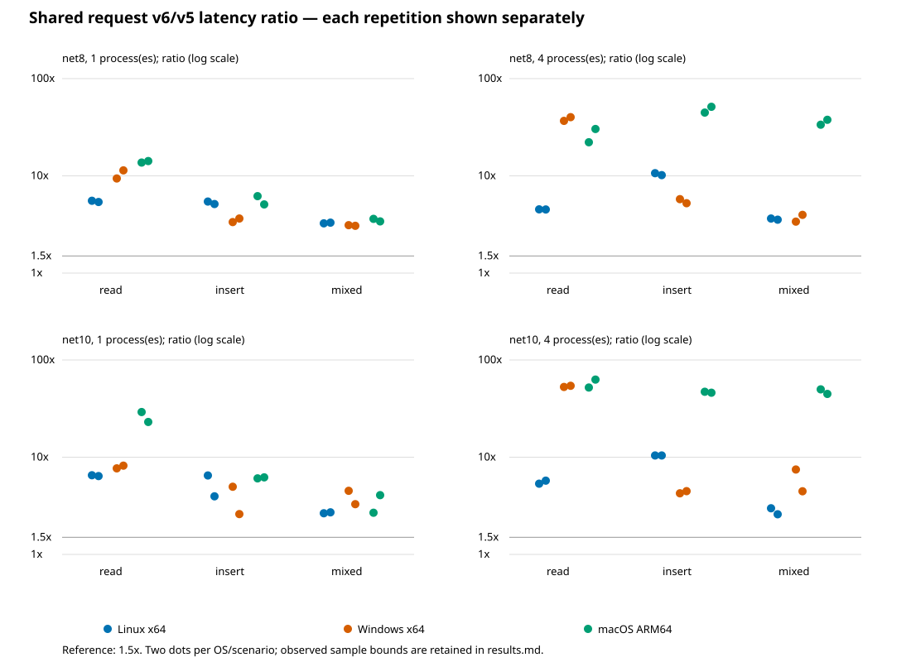

# P5-SHARED-REQUEST

**Measurements complete; qualification BLOCKED by a macOS concurrent admission failure and ratios above 1.5x.** Orchestrator instructed report-only per-request Shared comparisons against NuGet 5.0.21, twice on Linux x64, Windows x64 and macOS ARM64, net8/net10. No production changes or existing threshold changes.

Product baseline verified by `git ls-remote origin refs/heads/v6/phase4`: `7000dd6f01d0187a8fb5d030064eb327864ab731`. Scratch harness starts at Shared-open report `3b1f280b69c44a90add2948f6968de921f57bb5b`.

## Results

Ranges below span the four **separate** median ratios (net8/net10 × repetitions 1/2); no samples are pooled. Scenario (a) = one point read, (b) = one insert, (c) = ten reads plus one update. All 72 cell medians exceed 1.5x. Exact per-runtime/repetition milliseconds, sample min/max and conservative ratio bounds are in [results.md](results.md); [summary.json](summary.json) also retains aggregate throughput separately.

| Platform | Processes | (a) read | (b) insert | (c) mixed |
| --- | ---: | ---: | ---: | ---: |
| Linux x64 | 1 | 5.38–6.52x | 3.96–6.49x | 2.65–3.30x |
| Linux x64 | 4 | 4.51–5.74x | 10.17–10.65x | 2.59–3.64x |
| Windows x64 | 1 | 7.68–11.38x | 2.60–4.97x | 3.06–4.51x |
| Windows x64 | 4 | 36.76–54.24x | 4.25–5.76x | 3.38–7.47x |
| macOS ARM64 | 1 | 13.69–29.13x | 5.08–6.20x | 2.68–4.07x |
| macOS ARM64 | 4 | 22.16–62.82x | 44.73–51.31x | 33.57–49.84x |

Each retained job completed 144 samples. The independent audit accepted all 864 expected samples and all 2160 worker outputs, verified exact source/binary identity, actual .NET 8.0.33/.NET 10.0.14 and X64/Arm64 execution, all correctness markers, and recomputed interval overlap. The macOS8 runtime describes its OS as Darwin; macOS10 uses macOS 15.8.2; Linux uses Ubuntu 24.04.5 LTS. These descriptions are explicitly supported by the audit. [artifact-sha256.json](artifact-sha256.json) pins each raw `all.json`. Raw evidence: `/tmp/litedb-proto/phases/p5-shared-request-evidence/`, also retained in the linked GitHub run artifacts (subject to retention).

Local verification: production Release net8 harness builds passed for both libraries; the evidence-audit unit check passed with complete synthetic inputs and rejected missing samples, wrong candidates, failed verification and mixed binaries. Python syntax, SVG XML, C# size and whitespace checks passed. No local timing or full suite ran.

## Method

The retained successful jobs supply six legs: Linux x64, Windows x64 and macOS ARM64, net8/net10. Each leg builds NuGet `[5.0.21]` and an independent checkout of exact phase4 `7000dd6f01d0187a8fb5d030064eb327864ab731`, Release, `TestingEnabled=false`. No PROFILE instrumentation. Tiered compilation is disabled for optimized first JITs. The v6 one-file and durable defaults and the default 1,000-page checkpoint are asserted. v5 Shared has no equivalent per-commit durable setting; this compares defaults, not equal durability guarantees.

Both repetitions share one hosted runner allocation per leg; they do not establish independent-host reproducibility. Each leg runs two repetitions, each with six alternating v5/v6 rounds per scenario and concurrency. Each sample uses a fresh 1,000-row database with 96-character payloads; each worker warms the exact operation ten times on its own separate database, then waits at a common filesystem barrier. The timed loop is 20 complete `new LiteDatabase(shared) -> work -> dispose` requests per worker. Four-process samples use one shared file; there is no persistent anchor connection. Linux net8/net10, Windows net10 and macOS net8 require all four measured worker intervals to overlap. The corrective macOS-net10/Windows-net8 harness uses 200 requests for the short read scenario, 20 for insert/mixed, and a coordinated future start; it requires at least two measured intervals to overlap and records peak overlap. Four gated worker processes execute each sample, but OS scheduling does not guarantee simultaneous execution of all four.

(a) finds one unchanged row by `_id`; (b) inserts one uniquely numbered row with an integer payload; (c) reads ten 96-character rows by `_id`, then updates one row owned by that process. Each operation is auto-committed; the mixed request has no explicit encompassing transaction. After every sample an independent reopen checks every seed payload/value and every inserted identity/value. There are no engine, format or safety machinery changes in this step; verification guards benchmark correctness and is not a new crash-safety qualification.

Primary latency is the arithmetic mean of worker elapsed/request values, followed by the median across the six rounds. This includes open, work, dispose, and in-loop result assertions. Startup, seed, warmup, barrier wait, and final verification are excluded. A secondary coordinated wall-time/request metric records aggregate throughput (including barrier release and polling overhead); it is retained separately in JSON and must not be interpreted as individual request latency. Bounds are observed sample min/max, and conservative ratio bounds `min(v6)/max(v5)` to `max(v6)/min(v5)`; they are not confidence intervals or latency percentiles. Repetitions, runtimes and platforms are never pooled.

Audit: `python docs/benchmarks/p5-shared-request/summarize.py <downloaded-artifacts> <output-directory> <measurement-identities.json>`. It requires all 864 samples, exact binary/source identity within each leg, expected architectures/runtime, all verification markers, and every round. Raw samples retain wall time, runtime, binary hashes, source SHAs and process intervals.

## Remaining open cost and candidates

The [Shared-open report](../p5-shared-open/report.md#cause-and-profile-evidence) contains the completed Linux/Windows net8 EventPipe profiles. Their diagnostic timings include observer overhead and overlap; these are neither additive budgets nor new request measurements. No macOS or net10 profile was captured there.

| Prior diagnostic ms/open-close | Linux x64 | Windows x64 |
| --- | ---: | ---: |
| Whole cycle | 2.435–2.534 | 3.104–3.199 |
| Protected registry attach, inclusive | 0.913–0.959 | 0.965–1.007 |
| Final close, inclusive | 0.395–0.465 | 0.621–0.645 |
| Canonicalization, all calls | 0.110–0.127 | 0.639–0.675 |
| External native admission, inclusive | 0.220–0.249 | 0.285–0.321 |
| Map disposal, both views | 0.051–0.058 | 0.078–0.087 |
| Volume checks, all calls | 0.007–0.009 | 0.018–0.022 |

Each cycle still performs seven physical opens, eighteen canonicalizations and five filesystem qualifications. Quiescent reuse was already active; allocation/reset and recovery sync did not dominate. Native DMS/WRITE acquisition was below 0.020ms/cycle in the earlier Windows trace. Eliminating locks or durability checks is not justified by that profile.

Candidate ranking, to investigate only; no implementation or claimed measured gains:

1. **Carry validated canonical identity through guards within the same admitted handle lifetime.** Estimate: avoid roughly half to most duplicate canonicalization, about 0.05–0.10ms on Linux and 0.3–0.6ms on Windows per isolated request. Those estimates are fractions of the prior diagnostic span, not predicted portable speedups. Preserve external facade admission and fresh identity checks at replacement boundaries; retain the actual native owner/handle, and reject aliases and changed generations. Require alias, rename/replacement, mixed-open exclusion, process-death and teardown interleaving tests. A pathname/global cache would not provide this safety argument.
2. **Consolidate repeated protected attach inspections and physical opens under one existing ownership scope.** Exploratory budget: 0.2–0.5ms Linux / 0.2–0.6ms Windows; low confidence until a finer profile separates nested work. Do not add this estimate to candidate 1: spans overlap. Preserve independent first-opener DB/WAL recovery, ephemeral envelope validation, writer/read admission order and mapping lifetime; test partial bootstrap, repeated recovery, last-close/open races and process death at each transition. Do not retain an idle implicit participant across disposal.
3. **Reduce duplicate final-close inspection/handle setup.** Exploratory budget: 0.1–0.2ms Linux / 0.1–0.3ms Windows, bounded by the inclusive 0.4–0.65ms final-close span. Keep final checkpoint, durable barriers, generation retirement and failure cleanup in order; require checkpoint-failure, interrupted close, repeated reopen and concurrent last-close tests. Removing final-close duties or deferring durability is outside this candidate.

The first candidate is the clearest measured duplication, especially on Windows; by itself it is unlikely to bring a large request regression down to 1.5x. Gains on macOS/net10 and under four-process contention cannot be inferred from the available profile. Keeping a database facade alive across requests would amortize lifecycle cost, but changes the requested application pattern and is not an implemented fix here.

## Hosted runs and corrections

| Run | Harness | Disposition |
| --- | --- | --- |
| [42578770514](https://github.com/litedb-org/LiteDB/actions/runs/42578770514) | `1ae1bed23` | Own superseded pilot cancelled; macOS mixed4 exceeded original 120s measurement limit with N100. Partial samples excluded. |
| [42580592723](https://github.com/litedb-org/LiteDB/actions/runs/42580592723) | `fd3ac4472` | Overall failure; retain successful Linux8/10, Windows10 and macOS8 jobs. Windows8 and macOS10 rejected short v5 reads because all-four timed intervals did not overlap. |
| [42581524907](https://github.com/litedb-org/LiteDB/actions/runs/42581524907) | `9453f357f` | Overall failure; retain successful macOS10. macOS8 failed with actual native-lock error35, disclosed below. |
| [42582866993](https://github.com/litedb-org/LiteDB/actions/runs/42582866993) | `287399ca2` | Success; retain Windows8 only. |

All runs were waited to a terminal state. No pending work is described as passing. Source/batch contracts are in [measurement-identities.json](measurement-identities.json); each retained leg contains two complete repetitions on its exact harness SHA, with the product always pinned to phase4. The final workflow matrix is deliberately scoped to the last Windows8 correction; the table identifies each full historical configuration for reproduction. No PRs, other-branch pushes, local benchmarks, engine fixes, or existing threshold changes.

The original pilot used 100 requests per worker. The final harness uses 20 (200 for corrected short-read cases) and an independent 600s measurement limit; the warmup/start barrier remains 120s. These are measurement-controller limits, not modified tests. The corrected start is 250ms in the future; worker latency excludes that delay, and its secondary wall metric subtracts it. Corrections retained four real worker processes and record actual overlap. No operation retries were added. The earlier macOS pilot insert4 observation 345.265ms/request v6 versus 3.344 v5 was only one round, never a final median.

## Concurrent admission blocker

The corrected macOS net8 job [129041126114](https://github.com/litedb-org/LiteDB/actions/runs/42581524907/job/129041126114) failed during v6 read4, repetition 1 round 3, with `System.IO.IOException: fcntl OFD lock failed (native error 35)`. The stack is `DatabaseFileLock.UnixLock -> Lock -> SharedRangeLocks.ShareDms -> SharedMemoryAuthority.Open -> SharedMemoryReaderTable.Open -> SharedParticipantRegistry.Attach -> SharedEngine` during construction. This is a real failed product operation under concurrent lifecycle churn; no retry or exclusion hides it. No comparable green dev run of this new workload is established, and it is not classified as a flake. The cause is not resolved in this report-only step. Raw log and partial samples are retained in the evidence directory.

The previous macOS net8 job on `fd3ac4472` completed all 144 samples with 20 requests per process and verified all-four overlap. Those completed ratios can describe that run; the later native lock error blocks a reliability/qualification claim. Final macOS net8 results therefore use that earlier completed leg. Windows net8 uses the corrective harness; both use the exact product SHA `7000dd6f0`. The identity manifest is authoritative for sample count and harness revision per leg.
